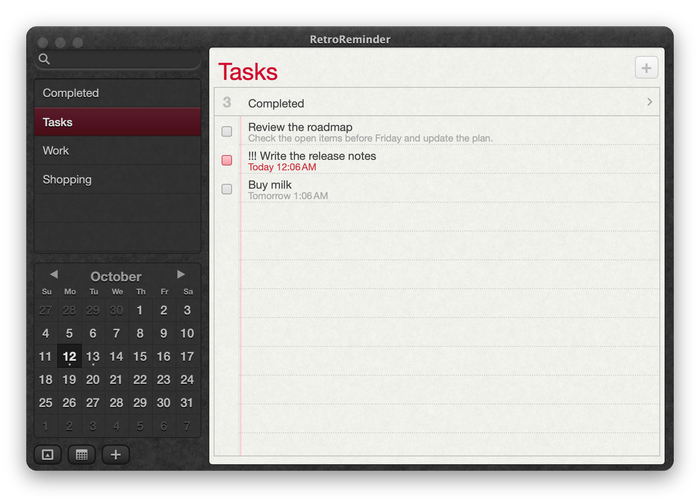
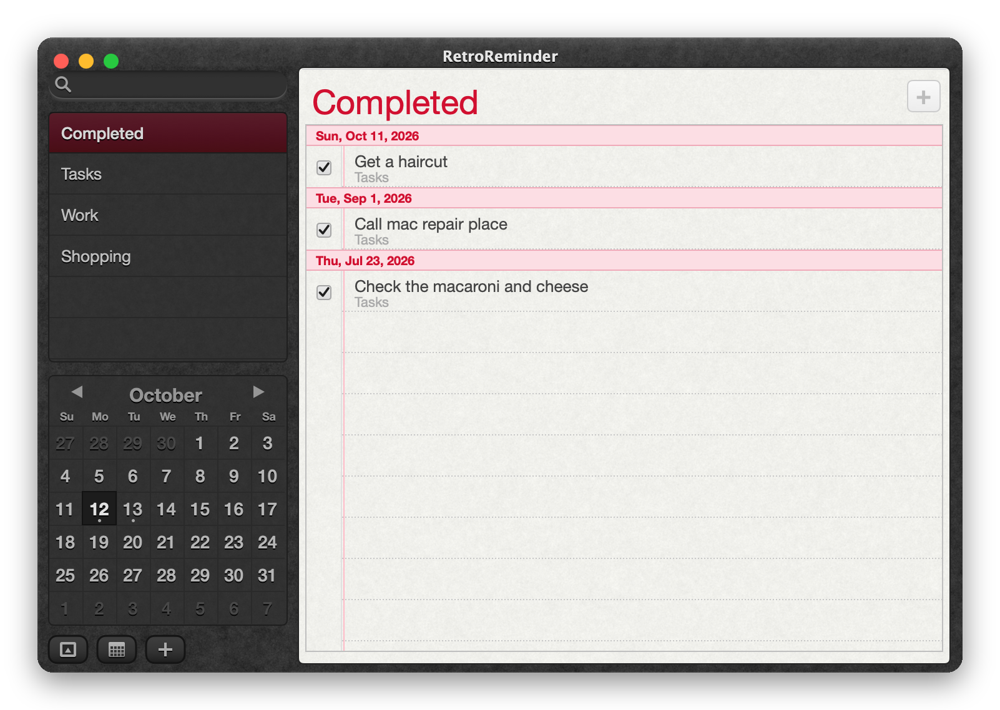
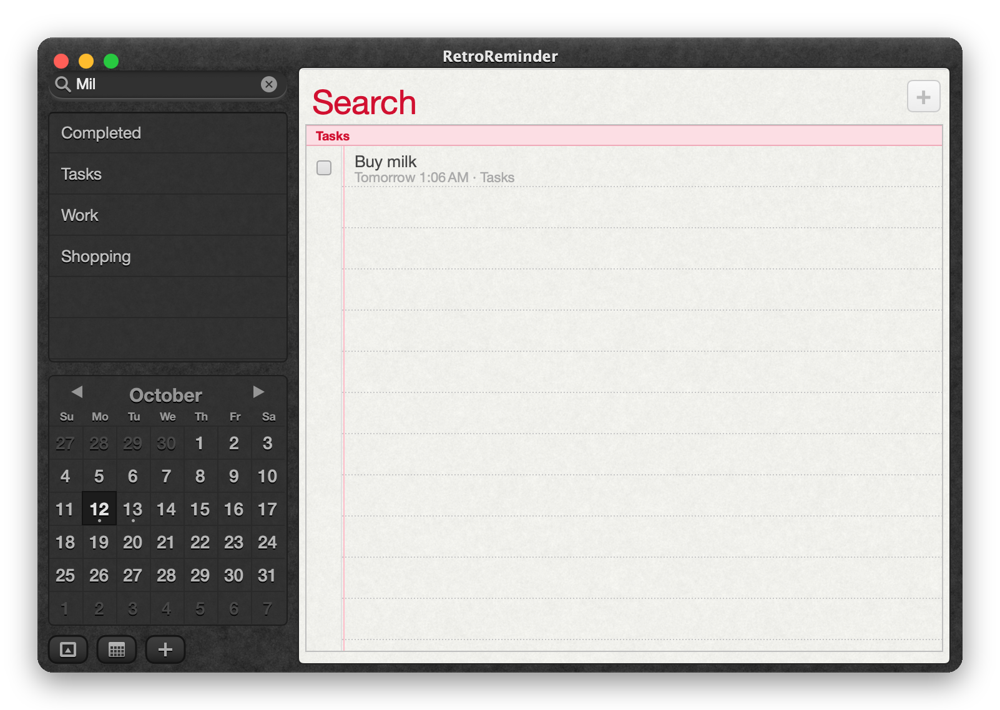
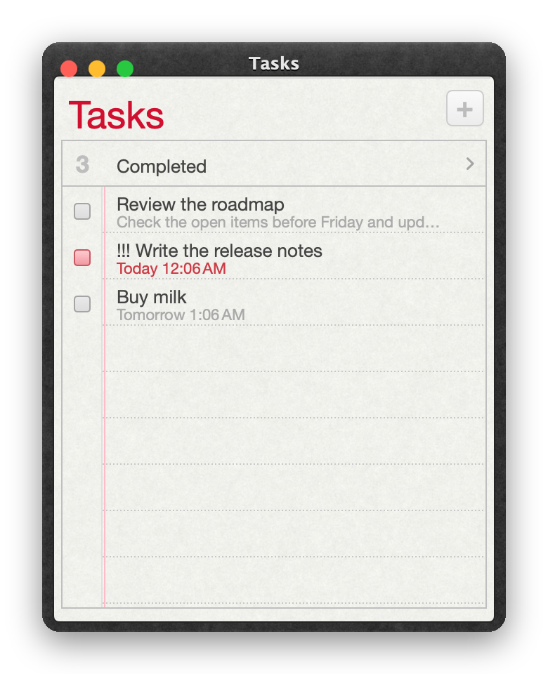
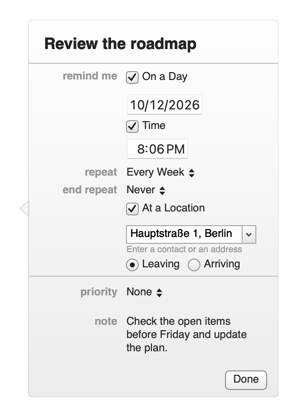
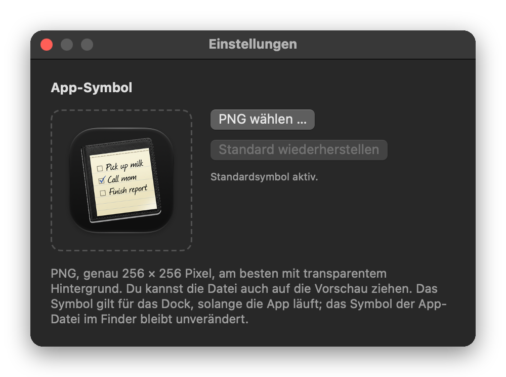

# RetroReminder

Ein nativer macOS-Aufgabenmanager im Stil der **Erinnerungen-App von OS X 10.8**: dunkles Leder, liniertes Papier, roter Rand, Minikalender – und echte Funktion dahinter, auch mit den Erinnerungen deines Macs. Open Source (MIT).

<p align="center"></p>

> Swift 5.9 · AppKit + SwiftUI · macOS 14 oder neuer · Apple Silicon und Intel · Deutsch und Englisch
>
> **Hinweis:** RetroReminder ist ein unabhängiges Projekt und steht in keiner Verbindung zu Apple Inc. Das Design ist von OS X 10.8 *inspiriert*. Apple, Mac, macOS, OS X und Mountain Lion sind Marken von Apple Inc.

## Funktionen

- **Listen und Aufgaben** – Titel, Notiz, Priorität (Keine/Niedrig/Mittel/Hoch), Fälligkeit mit oder ohne Uhrzeit, Wiederholung (täglich bis jährlich), Erledigt-Ansicht je Liste und global, Umordnen per Drag-and-drop, Verschieben zwischen Listen.
- **Suche, Kalender, Tagesansicht** – Suche beim Tippen, Klick auf einen Tag zeigt dessen Aufgaben, Punkte markieren Tage mit Erinnerungen.
- **Natürliche Datumseingabe** – „Paket abholen morgen um 18:30“ / „Call Alex tomorrow at 10am“ setzt die Fälligkeit und entfernt die Zeitangabe aus dem Titel.
- **Systemerinnerungen** (EventKit) – deine Listen aus der macOS-App „Erinnerungen“ erscheinen gruppiert nach Konto (z. B. iCloud); Lesen, Anlegen, Ändern, Erledigen, Löschen, Verschieben. Alarme übernimmt das System. Ein/Aus im Menü *Ablage › Systemerinnerungen verwenden*.
- **Lokale Erinnerungen und Mitteilungen** – eigener Datenbestand ohne Konto, Mitteilungen mit „15 Minuten später“; „Schließen“ erledigt die Aufgabe nicht.
- **Orte** – „An einem Ort“ mit Ankommen/Verlassen; die Adresse wird aufgelöst, ohne Auflösung gibt es keinen Ortsalarm.
- **Kompaktmodus** mit Seitenpunkten, Trackpad-Wischen mit Mitziehen, und **eigene Listenfenster** (⌘↩) – alle Fenster teilen denselben Datenbestand und werden beim Start wiederhergestellt.
- **Export** als `.ics` (VTODO).
- **Eigenes App-Symbol** – in *RetroReminder › Einstellungen …* (⌘,) ein PNG mit genau 256 × 256 Pixeln wählen oder auf die Vorschau ziehen; gilt für das Dock, „Standard wiederherstellen“ setzt es zurück.
- **Tastatur und VoiceOver** – alle Kernabläufe ohne Maus, Tab-Zonen, vollständige Bedienungshilfen (siehe unten).

## Bilder

<table>
<tr>
<td></td>
<td></td>
</tr>
<tr><td align="center">Deutsche Oberfläche</td><td align="center">Mehrere Listen (⌘-Klick)</td></tr>
<tr>
<td></td>
<td></td>
</tr>
<tr><td align="center">Erledigt, nach Datum gruppiert</td><td align="center">Suche beim Tippen</td></tr>
<tr>
<td> </td>
<td align="center"></td>
</tr>
<tr><td align="center">Kompaktmodus · Listenfenster</td><td align="center">Detail-Popover mit Tag, Wiederholung und Ort</td></tr>
<tr><td colspan="2" align="center"><br>Einstellungen: eigenes App-Symbol (PNG, 256 × 256)</td></tr>
</table>

*Alle Bilder zeigen Demo-Daten (`-demo`), keine echten Erinnerungen. Neu erzeugen: `./docs/make-screenshots.sh`.*

## Installation

Das signierte und notarisierte DMG hängt am [Release](../../releases):

```bash
gh release download --repo klotzbrocken/retroreminder --pattern '*.dmg'
open RetroReminder-*.dmg      # App in „Programme“ ziehen
```

Beim ersten Start fragt macOS einmal nach dem Zugriff auf **Erinnerungen** (und nur bei Ortserinnerungen nach der Ortung). Ohne Freigabe bleibt die App mit lokalen Listen voll nutzbar.

## Selbst bauen

```bash
./build.sh        # baut build/RetroReminder.app (signiert mit „Apple Development“, sonst ad-hoc)
./release.sh      # Developer ID + Hardened Runtime → Notarisierung → DMG → notarisieren/heften/prüfen
```

`release.sh` braucht ein Zertifikat „Developer ID Application“ im Schlüsselbund und ein `notarytool`-Profil (`NOTARY_PROFILE`, Standard `Retromac`). Hinweis: macOS bindet Datenschutz-Freigaben an die Signatur – mit stabilem Zertifikat kommt der Dialog nur einmal, mit ad-hoc-Signatur nach jedem Build.

## Tastatur

| Taste | Wirkung |
|---|---|
| ⌘N / ⌘L | neue Erinnerung / neue Liste |
| ↑ ↓ | Aufgabe wählen |
| Leertaste | gewählte Aufgabe erledigen/öffnen (nie im Textfeld) |
| Return | Aufgabe bearbeiten · im Suchfeld: erster Treffer · im Popover: Fertig |
| Esc | Bearbeitung abbrechen · Auswahl aufheben · Suche beenden · Popover schließen |
| ⌫ / ⌘⌫ | gewählte Aufgabe löschen |
| ⌘I · ⌘E | Informationen (Popover) · als erledigt markieren |
| Bearbeiten › In Liste verschieben | gewählte Aufgabe verschieben |
| ⌘F | Suche (blendet im Kompaktmodus die Seitenleiste ein) |
| ⌘T | Heute |
| ⌘[ / ⌘] · ← / → | vorherige / nächste Liste (← → nur im Kompaktmodus) |
| ⌥⌘K / ⌥⌘S | Kalender / Listen ein-/ausblenden |
| ⌘R · ⇧⌘⌫ | Liste umbenennen · löschen |
| ⌘↩ · ⌘0 | Liste in neuem Fenster · Hauptfenster |
| ⌘Z / ⇧⌘Z | im Textfeld: Eingabe; sonst Datenbestand (nur lokale Daten) |

**Tab / ⇧Tab** wechselt die Zone: Suche → Listen → Kalender → untere Knöpfe → Plus → Papier. In den Listen: ↑↓ Liste, Return umbenennen. Im Kalender: ←→ Tag, ↑↓ Woche, Bild↑↓ Monat, Home heute, Return/Leertaste Tag wählen.

## Barrierefreiheit

Jede Aufgabe ist ein VoiceOver-Element (Name, Priorität als Text, offen/erledigt, überfällig, Fälligkeit) mit Standardaktion „Erledigen“ und den Aktionen *Informationen*, *Titel bearbeiten*, *Löschen*. Kalendertage tragen das volle Datum samt „heute“, „ausgewählt“, „hat Erinnerungen“; Erledigen und Neuanlegen werden angesagt. Prüfliste für den manuellen Durchlauf: [VOICEOVER.md](VOICEOVER.md).

## Tests und Qualität

```bash
APP="build/RetroReminder.app/Contents/MacOS/RetroReminder"
"$APP" -selftest                                  # Parser, Serien (Monatsende), Alarm, Undo, Wischen, Listenfenster
"$APP" -demo -keytest -snap=/tmp/k.png            # Tastaturbedienung über synthetische Tastenereignisse
"$APP" -demo -axdump  -snap=/tmp/a.png            # Bedienungshilfen: Elementliste, Reihenfolge, Standardaktion
Reference/snap.sh && python3 Reference/diff.py    # Pixelvergleich gegen die Referenz (Reference/README.md)
```

**Wie genau ist der Nachbau?** Optisch eng am Original, aber *nicht pixelidentisch*: Gegen den Referenz-Screenshot weichen im Gesamtfenster rund 12 % der Pixel um mehr als 8/255 ab (Seitenleistenliste ~6 %, Suchfeld ~4–10 %, Papierkopf ~12 %). Der Rest ist Schriftglättung und Korn der Textur. Leder und Papier werden aus den *gemessenen Statistiken* der Referenz erzeugt (`Reference/make_textures.py`), nicht aus Original-Bitmaps.

## Aufbau

| Datei | Inhalt |
|---|---|
| `Sources/RetroReminder/Model.swift` | Datenmodell, Store (Persistenz, Undo, Serien), lokale Alarme |
| `EKBridge.swift` | Systemerinnerungen über EventKit |
| `ViewState.swift` | Zustand je Fenster: Ansichten, Zonen, Wischen, Fokus |
| `Views.swift`, `Paper.swift`, `Detail.swift` | Seitenleiste/Kalender, Papier/Zeilen, Popover |
| `Textures.swift` | Texturen, Verläufe aus gemessenen Zeilenprofilen |
| `App.swift` | Fenster, Menüs, Wiederherstellung, Test-Hilfen |
| `Preferences.swift` | Einstellungen: eigenes App-Symbol (PNG 256 × 256) |
| `SelfTest.swift` | Selbsttest (`-selftest`) |
| `Reference/` | Messwerkzeuge für den Referenzvergleich |

Daten: lokale Erinnerungen in `~/Library/Application Support/RetroReminder/store.json` (ein älterer Ordner „MountainLionReminders“ wird beim ersten Start übernommen) (atomar geschrieben, beschädigte Dateien werden gesichert); Systemerinnerungen bleiben ausschließlich im System.

## Grenzen

- Mindest-/Maximalgrößen (440×450 … 1000×700, kompakt 300–360 breit) sind Testvorgaben, nicht am Original gemessen.
- Deutsche Beschriftungen sind begründete Arbeitsnamen; eine deutsche Original-Referenz fehlt.
- Ortsalarme: Koordinaten werden gespeichert und ans System gegeben; das tatsächliche Auslösen ist nicht nachgewiesen.
- Rückgängig gilt nur für lokale Daten; Systemerinnerungen sind davon ausgenommen.
- Komplexe Wiederholungen (z. B. „jeden 2. Dienstag“) bleiben im System unverändert und werden nicht angezeigt.

## Lizenz und Rechtliches

- **Code:** MIT-Lizenz, siehe [LICENSE](LICENSE).
- **Keine Verbindung zu Apple:** RetroReminder ist ein unabhängiges Open-Source-Projekt und wird von Apple weder autorisiert noch unterstützt. Das Aussehen ist von OS X 10.8 inspiriert; es sind keine Apple-Bilder, -Schriften, -Töne oder -Texturen enthalten (Leder und Papier werden aus gemessenen Statistiken erzeugt, Schriften stammen aus dem installierten System). Apple, Mac, macOS, OS X und Mountain Lion sind Marken von Apple Inc.
- **App-Symbol:** `Resources/icon-source.png` und `AppIcon.icns` sind **nicht** von der MIT-Lizenz abgedeckt; sie stammen aus einer vom Autor mit KI erzeugten Bilddatei. Forks sollten ein eigenes Symbol verwenden – dafür gibt es die Einstellung *App-Symbol* (PNG 256 × 256).
- **Referenzbilder** für den Pixelvergleich werden nicht mitgeliefert (`Reference/out/` ist ausgeschlossen); die Messskripte erwarten sie lokal.
- **Vertrieb:** ausschließlich über GitHub (Quellcode und notarisierte Releases), nicht über den App Store.
