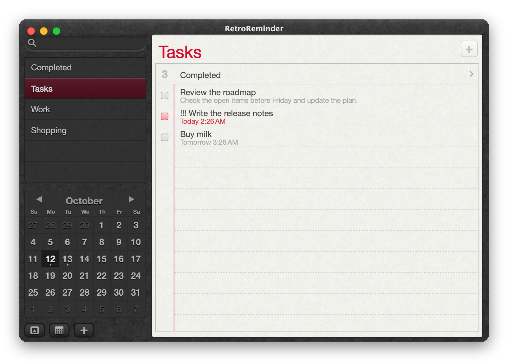
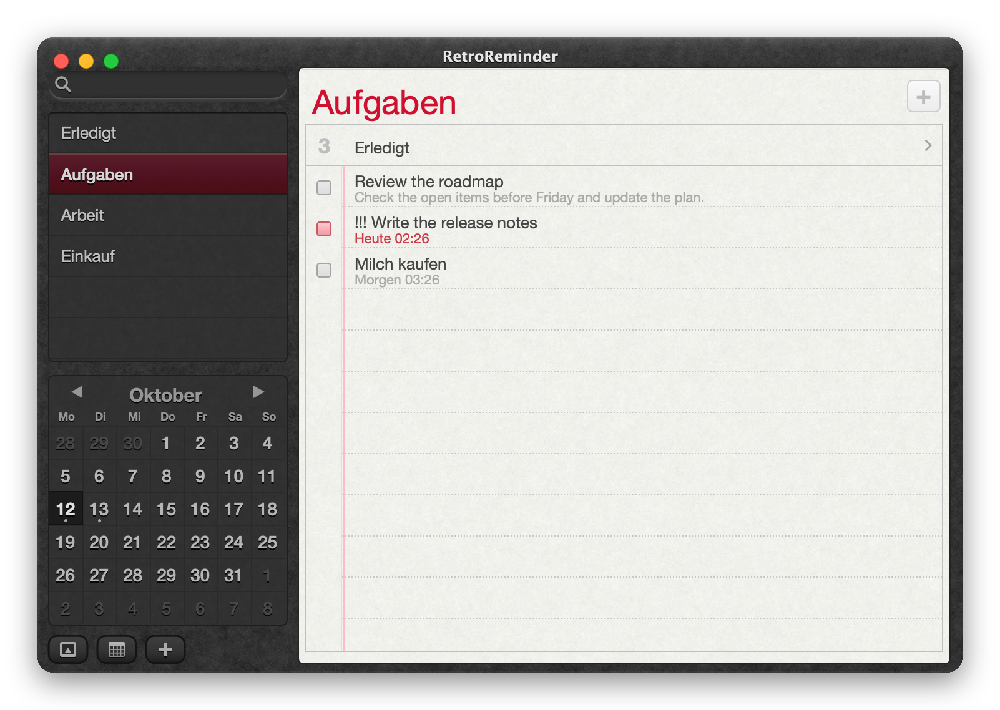
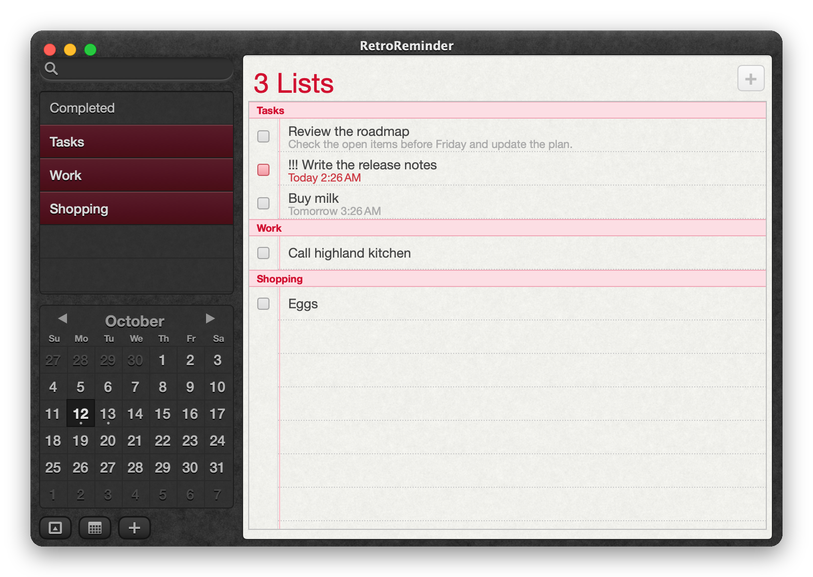
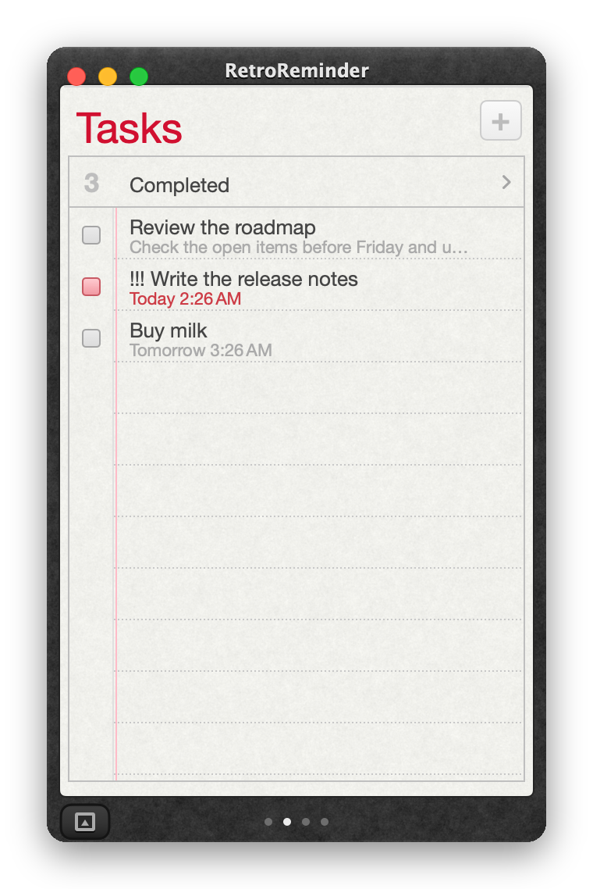
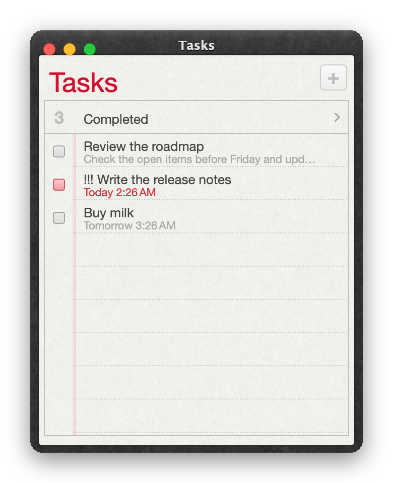
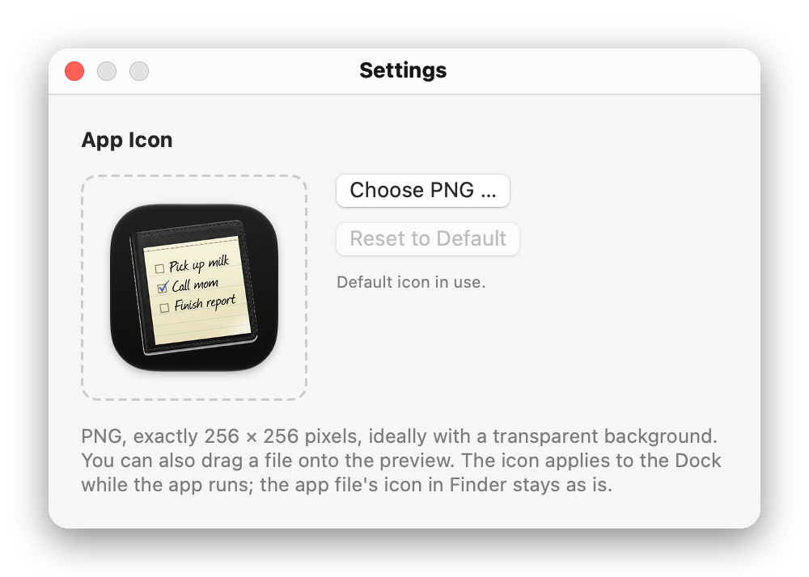

# RetroReminder

A native macOS task manager in the style of the **Reminders app of OS X 10.8**: dark leather, lined paper, red margin, mini calendar – with real functionality behind it, including your Mac's own reminders.

<p align="center"></p>

> Swift 5.9 · AppKit + SwiftUI · macOS 14 or later · Apple Silicon and Intel · English and German · GPL-3.0
>
> **Note:** RetroReminder is a non-commercial fan project, made out of respect for Apple. It is an independent project and is not affiliated with Apple Inc. The design is *inspired by* OS X 10.8. Apple, Mac, macOS, OS X and Mountain Lion are trademarks of Apple Inc.

## Features

- **Lists and tasks** – title, note, priority (none/low/medium/high), due date with or without time, repeat (daily to yearly), completed view per list and global, drag-and-drop reordering, moving between lists.
- **Search, calendar, day view** – search as you type; click a day to see its tasks; dots mark days with reminders.
- **Natural-language dates** – "Pick up parcel tomorrow at 6:30pm" / "Call Alex tomorrow at 10am" sets the due date and removes the time phrase from the title.
- **System reminders (EventKit)** – your lists from the macOS Reminders app appear grouped by account (e.g. iCloud); read, create, edit, complete, delete, move. Alarms are handled by the system. Toggle in *File › Use System Reminders*.
- **Local reminders and notifications** – own data store without an account, notifications with "15 minutes later"; "Close" does not complete the task.
- **Locations** – "At a location" with arriving/leaving; the address is resolved, without resolution there is no location alarm.
- **Compact mode and list windows** – compact mode with page dots and trackpad swipe, plus separate list windows (⌘↩); all windows share one data store and are restored at launch.
- **Export** – `.ics` (VTODO).
- **Custom app icon** – in *RetroReminder › Settings …* (⌘,) choose a PNG of exactly 256 × 256 pixels or drop it on the preview; applies to the Dock, "Reset to Default" restores it.
- **Keyboard and VoiceOver** – all core flows without a mouse, tab zones, full accessibility support (see below).
- **Privacy** – local data stays on your Mac, no network access; Reminders access is requested once, location only for location alarms.

## Screenshots

<table>
<tr>
<td></td>
<td></td>
</tr>
<tr><td align="center">German user interface</td><td align="center">Several lists (⌘-click)</td></tr>
<tr>
<td></td>
<td></td>
</tr>
<tr><td align="center">Completed, grouped by date</td><td align="center">Search as you type</td></tr>
<tr>
<td> </td>
<td align="center"></td>
</tr>
<tr><td align="center">Compact mode · List window</td><td align="center">Detail popover with tag, repeat and location</td></tr>
<tr><td colspan="2" align="center"><br>Settings: custom app icon (PNG, 256 × 256)</td></tr>
</table>

*All images show demo data (`-demo`), not real reminders. Re-create them with `./docs/make-screenshots.sh`.*

## Installation

Download the signed and notarized DMG from the [latest release](../../releases):

```bash
gh release download --repo klotzbrocken/retroreminder --pattern '*.dmg'
open RetroReminder-*.dmg      # drag the app to "Applications"
```

On first launch macOS asks once for access to **Reminders** (and for location only with location reminders). Without permission the app stays fully usable with local lists.

## Build from source

```bash
./build.sh        # builds build/RetroReminder.app (signed with "Apple Development", otherwise ad hoc)
./release.sh      # Developer ID + hardened runtime → notarize → DMG → notarize/staple/verify
```

`release.sh` needs a "Developer ID Application" certificate in the keychain and a `notarytool` profile (`NOTARY_PROFILE`, default `Retromac`). Note: macOS ties privacy permissions to the signature – with a stable certificate the dialog appears once, with an ad-hoc signature after every build.

## Keyboard shortcuts

| Key | Action |
|---|---|
| ⌘N / ⌘L | new reminder / new list |
| ↑ ↓ | select task |
| Space | complete/open selected task (never inside a text field) |
| Return | edit task · in search: first hit · in popover: Done |
| Esc | cancel editing · clear selection · end search · close popover |
| ⌫ / ⌘⌫ | delete selected task |
| ⌘I · ⌘E | info (popover) · mark as completed |
| Edit › Move to List | move selected task |
| ⌘F | search (shows the sidebar in compact mode) |
| ⌘T | Today |
| ⌘[ / ⌘] · ← / → | previous / next list (← → in compact mode only) |
| ⌥⌘K / ⌥⌘S | show/hide calendar / lists |
| ⌘R · ⇧⌘⌫ | rename list · delete list |
| ⌘↩ · ⌘0 | list in new window · main window |
| ⌘Z / ⇧⌘Z | in a text field: typing; otherwise the data store (local data only) |

**Tab / ⇧Tab** switches zones: search → lists → calendar → bottom buttons → plus → paper. In the lists: ↑↓ list, Return rename. In the calendar: ←→ day, ↑↓ week, Page ↑↓ month, Home today, Return/Space select day.

## Accessibility

Every task is a VoiceOver element (name, priority as text, open/completed, overdue, due date) with the default action "Complete" and the actions *Info*, *Edit title*, *Delete*. Calendar days carry the full date including "today", "selected", "has reminders"; completing and creating are announced. Checklist for manual testing: [VOICEOVER.md](VOICEOVER.md).

## Testing

```bash
APP="build/RetroReminder.app/Contents/MacOS/RetroReminder"
"$APP" -selftest                                  # parser, repeats (month end), alarms, undo, swipe, list windows
"$APP" -demo -keytest -snap=/tmp/k.png            # keyboard operation via synthetic key events
"$APP" -demo -axdump  -snap=/tmp/a.png            # accessibility: element list, order, default action
Reference/snap.sh && python3 Reference/diff.py    # pixel comparison against the reference (Reference/README.md)
```

**How close is the recreation?** Visually close to the original but *not pixel-identical*: against the reference screenshot about 12 % of the pixels of the whole window differ by more than 8/255 (sidebar list ~6 %, search field ~4–10 %, paper header ~12 %). The rest is font smoothing and texture grain. Leather and paper are generated from the *measured statistics* of the reference (`Reference/make_textures.py`), not from original bitmaps.

## Project layout

| File | Purpose |
|---|---|
| `Sources/RetroReminder/Model.swift` | data model, store (persistence, undo, repeats), local alarms |
| `EKBridge.swift` | system reminders via EventKit |
| `ViewState.swift` | per-window state: views, zones, swipe, focus |
| `Views.swift`, `Paper.swift`, `Detail.swift` | sidebar/calendar, paper/rows, popover |
| `Textures.swift` | textures, gradients from measured row profiles |
| `App.swift` | windows, menus, restoration, test helpers |
| `Preferences.swift` | settings: custom app icon (PNG 256 × 256) |
| `SelfTest.swift` | self-test (`-selftest`) |
| `Reference/` | measuring tools for the reference comparison |

## Data & privacy

Local reminders live in `~/Library/Application Support/RetroReminder/store.json` (an older "MountainLionReminders" folder is imported on first launch; written atomically, damaged files are backed up). System reminders stay exclusively in the system. No network access.

## Limitations

- Minimum/maximum sizes (440×450 … 1000×700, compact 300–360 wide) are test values, not measured on the original.
- German labels are reasoned working names; a German original reference is missing.
- Location alarms: coordinates are stored and handed to the system; actual triggering is not verified.
- Undo applies to local data only; system reminders are excluded.
- Complex repeats (e.g. "every 2nd Tuesday") stay unchanged in the system and are not shown.
- Reference images for the pixel comparison are not shipped (`Reference/out/` is excluded); the measuring scripts expect them locally.

## License & legal

- **Code:** [GNU General Public License v3.0](LICENSE) (GPL-3.0). Copyright © 2026 Maik Klotz.
- **Fan project:** RetroReminder is a non-commercial fan project, made out of respect and admiration for Apple and the design of OS X 10.8. It is free of charge, makes no claim to any Apple trademark, design or artwork, and is provided "as is" without warranty (GPL-3.0, sections 15–16). If you are a rights holder and have a concern, please open an issue – I will respond promptly and in good faith.
- **No affiliation with Apple:** RetroReminder is an independent open-source project, neither authorized nor endorsed by Apple. No Apple images, fonts, sounds or textures are included (leather and paper are generated from measured statistics, fonts come from the installed system). Apple, Mac, macOS, OS X and Mountain Lion are trademarks of Apple Inc.
- **App icon:** `Resources/icon-source.png` and `AppIcon.icns` are AI-generated and are **not** covered by the GPL; all rights reserved. Forks should use their own icon – the *App Icon* setting (PNG 256 × 256) exists for that.
- **Distribution:** GitHub only (source and notarized releases), not the App Store.
